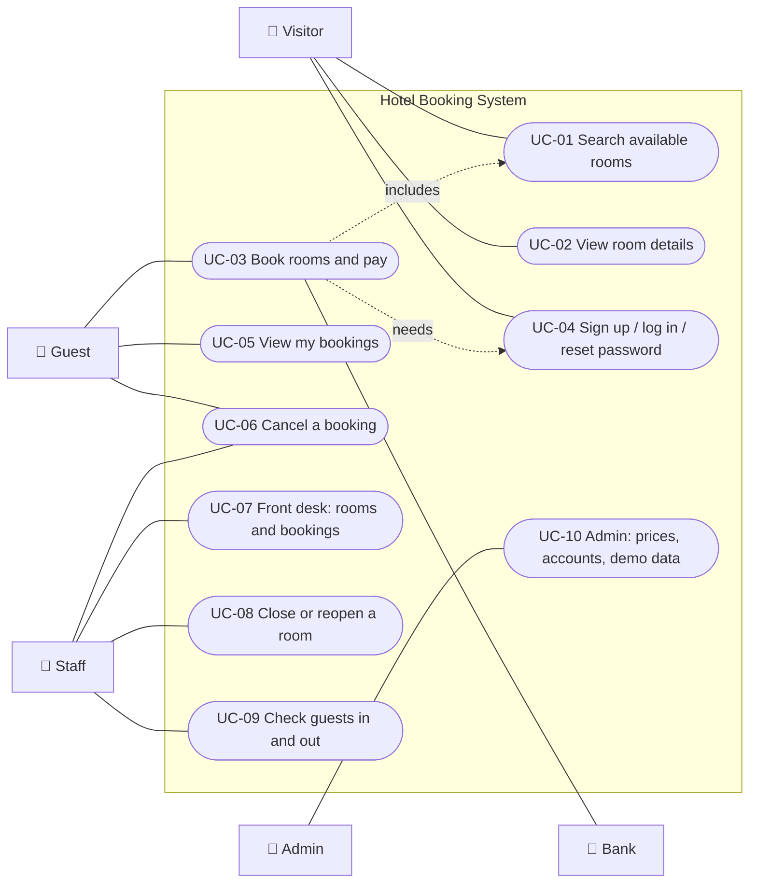

# Hotel Booking System — Use Cases

**Author:** 24B032036 (Tester / Systems Analysis & Requirements)
**Version:** 2.0, 13 Nov 2026 — updated for the version with accounts, roles and the Django API
**Tests for each use case:** `test-cases.md`

## Actors

| Actor | Who it is | What they can do |
|---|---|---|
| **Visitor** | Person without an account | Search rooms, see room details, sign up |
| **Guest** | Person with an account (role *guest*) | Book and pay, see and cancel own bookings, edit profile, change password |
| **Staff** | Front-desk employee (role *staff*) | Everything a guest can + see all rooms and bookings, check guests in and out, close rooms for repair, cancel any booking |
| **Admin** | Administrator (role *admin*) | Everything staff can + change room prices, manage accounts and roles, reset demo data |
| **Bank** (external) | Card payment service (simulated) | Accept or decline a card |

## Use case diagram

A guest is also a visitor; staff can do everything a guest can; admin can do everything staff can.

## Main user process (end to end)

Visitor searches dates → picks rooms → logs in or signs up (the rooms are kept) → pays → gets a booking number HB-xxxx → sees it in *My account* → staff checks the guest in and out.
This is UC-01 → UC-04 → UC-03 → UC-05 → UC-09.

## Business rules

| Rule | Text | Where it is checked |
|---|---|---|
| BR-1 | One room cannot be in two active bookings (Confirmed / CheckedIn) for overlapping dates | Backend `frontend_api.py` + database trigger (`05_business_rules.sql`) |
| BR-2 | Guests in a room ≤ capacity of its room type | Backend + database trigger |
| BR-3 | Check-out after check-in; check-in not in the past | Website, backend, database CHECK |
| BR-4 | Total = room price per night × nights; the price is saved in the booking, so a later price change does not change old bookings | Backend (`booking_room.price_per_night`) |
| BR-5 | One email = one account (letter case does not matter) | Backend + UNIQUE in the database |
| BR-6 | Personal data (name, email, phone) and payments are shown only to the owner and to staff/admin | Backend `views.py` (fixed 13 Nov) |
| BR-7 | A phone number has at least 6 digits | Website + backend (fixed 13 Nov) |
| BR-8 | Password: at least 8 characters, a letter and a digit; stored only as a hash | Website + backend |

---

## UC-01 Search available rooms
**Actor:** Visitor (anyone). **Goal:** see how many rooms of each type are free for the dates.
1. Visitor enters check-in, check-out and number of guests, presses **Show available rooms**.
2. System counts free rooms: status *Available* and no active booking on overlapping dates.
3. System shows "X of Y left" per type, price per night and for the whole stay.

Alternatives: check-out not after check-in / check-in in the past / guests not 1–10 → error message; no free room → *Sold out*, **+** disabled.
**Tests:** UI-01…UI-05, UI-07, UI-08, DB-09

## UC-02 View room details
**Actor:** Visitor. **Goal:** see photos, size, capacity and price before booking.
1. Visitor presses **See photos and details** → window with photos, description, capacity, price. 2. **Close**.
**Tests:** UI-06

## UC-03 Book rooms and pay
**Actors:** Guest, Bank. **Precondition:** logged in (UC-04), at least one room free.
**Success:** booking + one line per room + payment saved in ONE transaction. **Failure:** nothing saved (ROLLBACK).
1. Guest picks rooms (**+**), presses **Continue**. Not logged in → login form, rooms are kept.
2. Guest checks name and phone (taken from the account), chooses Card / Cash / Bank transfer.
3. System locks the rooms, checks they are open and not booked by someone else, saves booking, rooms and payment, COMMIT.
4. System shows **Booking confirmed**, number HB-xxxx and the steps the database did.

Alternatives: rooms too small for the group → Continue disabled; wrong card number → error; bank declines (demo: card ending 0000) → ROLLBACK; room just taken → ROLLBACK.
**Tests:** UI-15…UI-19, DB-10…DB-27

## UC-04 Sign up / log in / reset password
**Actor:** Visitor.
1. **Sign up:** first and last name, email, phone, password twice, accept terms → account created, logged in, *My account* opens.
2. **Log in:** email + password → the page for the role opens (guest → My account, staff → Front desk, admin → Admin).
3. **Forgot password:** email → link valid 1 hour → new password.

Alternatives: email already used → error; weak password → error; phone without digits → error; wrong password → *"Invalid email or password."* (same text for unknown email); blocked account → cannot log in.
**Tests:** UI-09…UI-14, API-04, unit tests in `backend/booking/tests.py`

## UC-05 View my bookings
**Actor:** Guest. 1. **My account** → upcoming and past bookings with dates, rooms, total, payment status. Only own bookings.
**Tests:** UI-14, UI-21, API-01…API-03

## UC-06 Cancel a booking
**Actors:** Guest (own booking) or Staff (any). **Precondition:** status *Confirmed*.
1. **Cancel booking HB-xxxx** → status *Cancelled*, payment *Refunded*, rooms free again.
**Tests:** UI-20

## UC-07 Front desk: rooms and bookings
**Actor:** Staff (or Admin). Visitors and guests get a login form / "This page is not for your account".
1. **Front desk** → today's arrivals and departures, all bookings with filters and search, every room for a date range: *Free*, *Booked by … (HB-xxxx)* or *Closed for maintenance*.
**Tests:** UI-22, UI-23

## UC-08 Close or reopen a room
**Actor:** Staff. 1. **Close for maintenance** → room status *Maintenance*, guests no longer see it as free. 2. **Reopen room** → *Available*.
**Tests:** UI-24, DB-18

## UC-09 Check guests in and out
**Actor:** Staff. 1. On the arrival day: **Check in** (*Confirmed → CheckedIn*). 2. **Check out** (*CheckedIn → Completed*).
**Tests:** UI-25

## UC-10 Admin: prices, accounts, demo data
**Actor:** Admin.
1. **Room prices:** new price per night; old bookings keep their price (BR-4).
2. **Users and roles:** change role guest / staff / admin, block or remove a login (not your own).
3. **Database:** see the tables; **Reset demo data**.
**Tests:** UI-26
